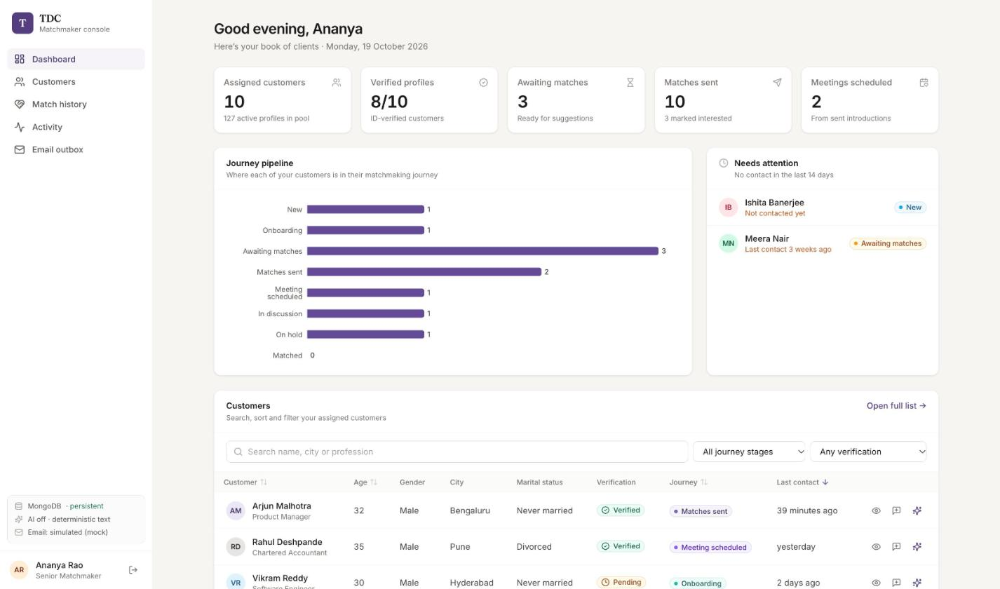
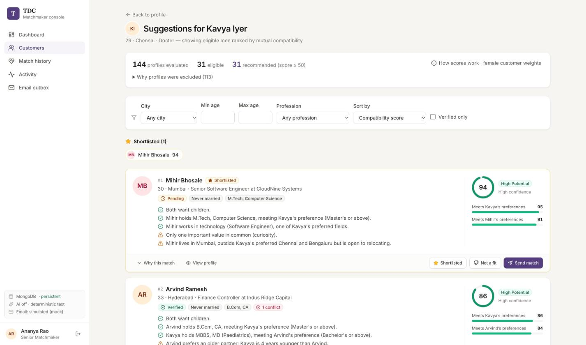
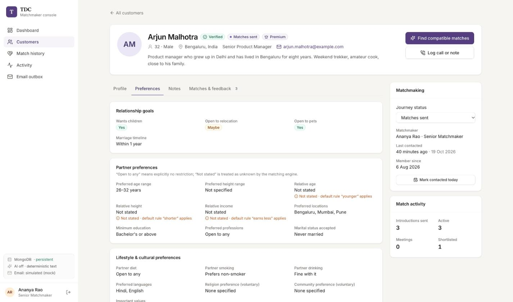

# TDC Matchmaker Console

An internal tool for TDC matchmakers. Sign in, manage your assigned clients' matchmaking journeys, review full matrimonial biodata, generate **ranked and explainable** match suggestions from a pool of 144 fictional profiles, log calls and notes, send simulated match introductions, and track feedback.

> **Status:** working MVP, verified locally (see [Testing & verification](#testing--verification)). It has **not** been deployed. Deployment configuration is included, but no live URLs exist.

---

| Dashboard                                    | Match suggestions (female customer)                          | Customer preferences (male, default rules shown)                   |
| -------------------------------------------- | ------------------------------------------------------------ | ------------------------------------------------------------------ |
|  |  |  |

## Contents

- [Features](#features)
- [Architecture](#architecture)
- [Quick start](#quick-start)
- [Environment variables](#environment-variables)
- [Database & seeding](#database--seeding)
- [Demo credentials](#demo-credentials)
- [API reference](#api-reference)
- [Matching algorithm](#matching-algorithm)
- [AI integration & fallback](#ai-integration--fallback)
- [Security & privacy](#security--privacy)
- [Testing & verification](#testing--verification)
- [Deployment (Vercel + Render)](#deployment-vercel--render)
- [Known limitations & future work](#known-limitations--future-work)

---

## Features

| Area                         | What's there                                                                                                                                                                                                                                                                                                                                                                                                                                                                                           |
| ---------------------------- | ------------------------------------------------------------------------------------------------------------------------------------------------------------------------------------------------------------------------------------------------------------------------------------------------------------------------------------------------------------------------------------------------------------------------------------------------------------------------------------------------------ |
| **Login**                    | Username or email plus password. Show/hide password. Zod validation on client and server. A generic invalid-credentials message. Rate-limited (10 attempts per 15 min). httpOnly JWT cookie session restored via `/auth/me`. Protected routes and logout. Demo accounts are listed in development only (served by the API, never bundled).                                                                                                                                                             |
| **Dashboard**                | Stats for assigned customers, verified profiles, customers awaiting matches, matches sent and meetings scheduled. Journey-pipeline and introduction-outcome charts. A "needs attention" list (no contact in 14+ days). Recent activity. An embedded searchable, sortable, filterable, paginated customer table with quick actions.                                                                                                                                                                     |
| **Customers**                | Search by name, city or profession. Filters for journey status, gender, verification and marital status. Sort by name, age, journey or last contact. Filter state lives in the URL. Empty states and a reset-filters action. Click a row to open the profile.                                                                                                                                                                                                                                          |
| **Customer profile**         | Tabs: Profile (personal, education & career, family & background, lifestyle), Preferences (relationship goals, partner preferences, cultural preferences, deal-breakers), Notes (add, edit, delete with confirmation), and Matches & feedback. A matchmaking side panel with journey status (confirmed change), owner, last contacted, "mark contacted" and stats.                                                                                                                                     |
| **Match suggestions**        | Opposite-gender, eligible candidates ranked by a deterministic 0–100 score with band and confidence. Filters for city, age range, profession and verified-only; sort by score, confidence, age or name. Each card shows strengths and considerations, a per-category breakdown with every individual check, both people's fit meters, and the assumptions applied. Plus "Summarise this match" (AI or fallback), View profile (drawer), Shortlist, Not a fit (with reason, restorable) and Send match. |
| **Send match**               | A modal with both profile summaries and the score. The introduction is drafted by AI or a deterministic template, editable, with Regenerate. A required confirmation checkbox, a server-side `confirm: true`, and duplicate prevention in four layers. The email is clearly labelled as **simulated** and written to the outbox; a toast confirms it and the lists refresh.                                                                                                                            |
| **Match history & feedback** | All introductions with customer → candidate, score, band, time sent, matchmaker and latest note. Status changes (Pending, Interested, Not interested, Meeting scheduled, Rejected) go through a confirmation dialog with an optional note and a full status history.                                                                                                                                                                                                                                   |
| **Activity**                 | A day-grouped timeline of notes, introductions, feedback, shortlists/dismissals and journey changes, filterable by customer.                                                                                                                                                                                                                                                                                                                                                                           |
| **Email outbox**             | Every simulated email (to the customer and the candidate), labelled "Simulated".                                                                                                                                                                                                                                                                                                                                                                                                                       |

**Automatic journey transitions** (each one logged in the activity timeline):

- Sending an introduction moves _New / Onboarding / Awaiting matches_ to **Matches sent** and updates "last contacted".
- Feedback of _Meeting scheduled_ moves _New / Onboarding / Awaiting matches / Matches sent / In discussion_ to **Meeting scheduled**.

**UX and accessibility details.** Loading skeletons, empty and error states with retry, success/error toasts in an `aria-live` region, and confirmation dialogs. Dialogs have a focus trap, close on Escape, restore focus, and stack correctly. Tabs follow the WAI-ARIA pattern with arrow keys. Focus states are visible, and there is a skip link. Charts include a screen-reader table. The layout is responsive (sidebar on desktop, drawer on mobile) and `prefers-reduced-motion` is respected.

---

## Architecture

```
.
├── apps/
│   ├── api/                      Express + TypeScript REST API
│   │   └── src/
│   │       ├── config/env.ts     Zod-validated environment config
│   │       ├── controllers/      Thin HTTP handlers (parse → service → respond)
│   │       ├── routes/           Route table (/api/…)
│   │       ├── services/         Business logic: customers, notes, matching, matches, AI, email, activity, dashboard
│   │       ├── middleware/       Auth (JWT cookie/Bearer), rate limits, central error handler
│   │       ├── models/           Mongoose schemas (profiles, matchmakers, notes, matches, decisions, activities, outbox)
│   │       ├── store/            Persistence adapters: MongoDB | JSON file | in-memory (tests) behind one interface
│   │       ├── seed/             Deterministic, idempotent seed (3 matchmakers, 14 clients, 130 members, history)
│   │       ├── validators/       Route param validation
│   │       └── tests/            HTTP integration tests (Vitest)
│   └── web/                      React 18 + Vite + Tailwind + React Router + RHF/Zod + Recharts + Lucide
│       └── src/
│           ├── components/       UI kit (Button, Badge, Field, Modal/Drawer, Toast, Tabs, Pagination, …) + status badges
│           ├── features/         auth, customers, matching, notes, activity, system
│           ├── pages/            Login, Dashboard, Customers, CustomerDetail, MatchSuggestions, MatchHistory, Activity, Outbox
│           ├── layouts/          App shell (sidebar, mobile nav)
│           ├── hooks/ lib/       useApi, API client, formatting
├── packages/
│   ├── shared/                   Domain types, enums + labels, API DTOs, Zod schemas (used by web AND api)
│   └── matching-engine/          Pure, framework-free scoring engine + 41 unit tests
├── MATCHING_ALGORITHM.md         Algorithm, AI, ethics write-up
├── render.yaml                   Render blueprint (API)
└── apps/web/vercel.json          Vercel config (web) with /api rewrite
```

**Key decisions**

- **npm workspaces monorepo.** The internal packages export TypeScript source. Vite, tsx and Vitest consume it directly, and `tsup` bundles it into the API build, so there is no separate package build step.
- **The engine has no dependencies** on Express, Mongo or React. It takes `now` as input, so it is deterministic and easy to test.
- **One persistence interface, three adapters.**
  - `DATA_STORE=auto` tries MongoDB and falls back to a JSON file. The fallback is logged, reported by `/api/health`, and shown in the sidebar.
  - The memory store is used only by tests and is always reported as **not persistent**. The UI shows a warning banner if it is ever active.
- **Session in an httpOnly cookie.** The web app never stores a token. In development the Vite proxy, and in production the Vercel rewrite, keep the API same-origin, so `SameSite=Lax` works.
- **Consistent response envelope.** Success is `{ data, meta? }` and errors are `{ error: { code, message, details? } }`. Internal errors are never leaked.

---

## Quick start

**Prerequisites:** Node.js ≥ 20.19 (tested on 20.20.2) and npm ≥ 10. MongoDB is optional; without it the API falls back to a local JSON file.

```bash
# 1. Install
npm install

# 2. Configure the API (defaults work out of the box; JWT_SECRET is generated per run in dev if unset)
cp apps/api/.env.example apps/api/.env
#    optional: set a stable JWT_SECRET (see the comment in the file) and OPENAI_API_KEY

# 3. Seed (idempotent; uses MongoDB at MONGODB_URI if reachable, otherwise apps/api/data/db.json)
npm run seed            # or: npm run seed:reset   (wipe and reseed)

# 4. Run API (http://localhost:4000) + web (http://localhost:5173)
npm run dev
```

Open **http://localhost:5173** and sign in with a [demo account](#demo-credentials).

| Command                               | What it does                                               |
| ------------------------------------- | ---------------------------------------------------------- |
| `npm run dev`                         | API (`tsx watch`) + web (Vite) together                    |
| `npm run seed` / `npm run seed:reset` | Insert missing demo data / wipe and reseed                 |
| `npm test`                            | Engine unit tests + API integration tests                  |
| `npm run typecheck`                   | `tsc` in all 4 workspaces (strict)                         |
| `npm run lint`                        | ESLint (typescript-eslint, react-hooks)                    |
| `npm run format` / `format:check`     | Prettier                                                   |
| `npm run build`                       | API bundle (`apps/api/dist`) + web build (`apps/web/dist`) |
| `npm start`                           | Run the built API (`node apps/api/dist/server.js`)         |

If no data has been seeded, the API auto-seeds an empty database on first start (`AUTO_SEED=true`).

---

## Environment variables

### API (`apps/api/.env`, template: `apps/api/.env.example`)

| Variable                    | Default                 | Notes                                                                                  |
| --------------------------- | ----------------------- | -------------------------------------------------------------------------------------- |
| `NODE_ENV`                  | `development`           | `production` enables secure cookies, hides demo credentials, and requires `JWT_SECRET` |
| `PORT`                      | `4000`                  |                                                                                        |
| `CORS_ORIGINS`              | `http://localhost:5173` | Comma-separated allow-list                                                             |
| `TRUST_PROXY`               | `false`                 | Set `true` behind Render or another proxy so rate limits see client IPs                |
| `DATA_STORE`                | `auto`                  | `auto` \| `mongo` \| `file` \| `memory` (tests only, not persistent)                   |
| `MONGODB_URI`               | —                       | e.g. `mongodb://127.0.0.1:27017/tdc_matchmaker` or an Atlas URI                        |
| `MONGO_CONNECT_TIMEOUT_MS`  | `3000`                  | How long `auto` waits before falling back                                              |
| `FILE_DB_PATH`              | `./data/db.json`        | JSON store location (gitignored)                                                       |
| `AUTO_SEED`                 | `true`                  | Seed when the database is empty                                                        |
| `JWT_SECRET`                | random (dev only)       | **Required in production**, ≥ 32 chars; the server refuses to start without it         |
| `SESSION_TTL_HOURS`         | `8`                     |                                                                                        |
| `COOKIE_SAMESITE`           | `lax`                   | Use `none` only for a cross-site deployment without the proxy (forces `Secure`)        |
| `COOKIE_SECURE`             | `true` in production    |                                                                                        |
| `SHOW_DEMO_CREDENTIALS`     | `true` in development   | Always off in production                                                               |
| `OPENAI_API_KEY`            | —                       | Optional; empty means deterministic fallbacks                                          |
| `OPENAI_MODEL`              | `gpt-4o-mini`           | Any chat model that supports JSON-schema structured outputs                            |
| `OPENAI_TIMEOUT_MS`         | `12000`                 |                                                                                        |
| `MATCHING_ASSIGNMENT_RULES` | `true`                  | Gender-specific weight profiles and male-customer relation defaults                    |
| `MATCHING_MIN_SCORE`        | `50`                    | Minimum score to recommend                                                             |
| `EMAIL_PROVIDER`            | `mock`                  | Only the mock provider exists; nothing is delivered                                    |

### Web (`apps/web/.env`, template: `apps/web/.env.example`)

| Variable              | Default                 | Notes                                                                                   |
| --------------------- | ----------------------- | --------------------------------------------------------------------------------------- |
| `VITE_API_BASE_URL`   | empty                   | Leave empty to call same-origin `/api` (recommended). The web app holds **no secrets**. |
| `VITE_DEV_API_TARGET` | `http://localhost:4000` | Dev proxy target (read by `vite.config.ts`)                                             |

---

## Database & seeding

- **MongoDB.** Collections: `profiles`, `matchmakers`, `notes`, `matches` (unique `pairKey`), `suggestion_decisions`, `activities` and `email_outbox`. Indexes are synced on start. Timestamps are ISO-8601 UTC strings in every adapter.
- **Fallback.** With `DATA_STORE=auto`, if Mongo is unreachable or `MONGODB_URI` is unset, the API uses `apps/api/data/db.json`. Writes are atomic (temp file + rename) and awaited before responding, so they genuinely persist across restarts; this was tested. The fallback reason is shown in `/api/health` and in the sidebar.
- **Seed contents:**
  - 3 matchmakers;
  - 14 hand-written clients (10 for Ananya, 4 for Rohan; 7 male and 7 female; a mix of verified, pending and unverified; every journey status represented);
  - 130 generated members (65 male, 65 female; ages 24–40; 11 Indian cities plus Singapore, Dubai and London with SGD/AED/GBP incomes; varied professions, education, languages, family structures and preferences);
  - 25 notes, 14 sent introductions with status histories, 28 outbox emails, 4 shortlist/dismiss decisions, and 59 activity events.
- **Reproducible.** Members come from a fixed-seed PRNG with a fixed epoch, so they are identical on every machine. Ages are always computed from `dateOfBirth`. Every income has an explicit currency.
- **Consistent history.** Seeded introductions are chosen by running the real matching engine for each client, so they are eligible and their score snapshots are genuine.
- **Idempotent.** Every seeded record has a deterministic id and is inserted only if missing. Running `npm run seed` twice inserts 0 records the second time (verified), and it never overwrites changes made in the app. `npm run seed:reset` wipes the collections and reseeds.

---

## Demo credentials

All demo accounts share the password **`TDCdemo@2026`**. The login page lists them in development only.

| Username | Email                   | Role                       | Sees           |
| -------- | ----------------------- | -------------------------- | -------------- |
| `ananya` | ananya.rao@tdc.example  | Senior Matchmaker          | Her 10 clients |
| `rohan`  | rohan.mehta@tdc.example | Matchmaker                 | His 4 clients  |
| `priya`  | priya.nair@tdc.example  | Head of Matchmaking (lead) | All 14 clients |

---

## API reference

Base path: `/api`. All request and response bodies are JSON.

**Envelopes:**

- Success: `{ "data": …, "meta"?: { page, pageSize, total, totalPages } }`
- Error: `{ "error": { "code", "message", "details"? } }`

**Authentication:** the `tdc_session` httpOnly cookie (set by login), or an `Authorization: Bearer <token>` header for API clients.

**Status codes:**

| Code | Meaning                                               |
| ---- | ----------------------------------------------------- |
| 400  | Validation error, with `details.fieldErrors`          |
| 401  | Unauthenticated or session expired                    |
| 404  | Not found, or a customer not assigned to you          |
| 409  | Duplicate introduction, or a send already in progress |
| 413  | Request body too large (limit 100 kB)                 |
| 422  | Pair not eligible                                     |
| 429  | Rate limited                                          |
| 500  | Generic error; details are never leaked               |

| Method | Path                                                      | Description                                                                                                                                                                                                                                                                   |
| ------ | --------------------------------------------------------- | ----------------------------------------------------------------------------------------------------------------------------------------------------------------------------------------------------------------------------------------------------------------------------- |
| GET    | `/health`                                                 | Public. Data store, persistence, fallback reason, AI enabled/model, email provider, matching config                                                                                                                                                                           |
| POST   | `/auth/login`                                             | `{ identifier, password }` → sets the cookie, returns `{ user, expiresAt, token }`                                                                                                                                                                                            |
| POST   | `/auth/logout`                                            | Clears the session cookie                                                                                                                                                                                                                                                     |
| GET    | `/auth/me`                                                | Current matchmaker (never includes the password hash)                                                                                                                                                                                                                         |
| GET    | `/auth/demo-credentials`                                  | Development only; 404 in production                                                                                                                                                                                                                                           |
| GET    | `/dashboard`                                              | Totals, journey and match-status distributions, needs-attention list, recent activity                                                                                                                                                                                         |
| GET    | `/customers`                                              | `?search&journeyStatus&gender&verification&maritalStatus&sort=name\|age\|lastContacted\|journeyStatus&order&page&pageSize`, paginated                                                                                                                                         |
| GET    | `/customers/:id`                                          | Full profile, computed age, owner, stats                                                                                                                                                                                                                                      |
| PATCH  | `/customers/:id`                                          | `{ journeyStatus?, lastContactedAt? }`; logged to activity                                                                                                                                                                                                                    |
| GET    | `/customers/:id/notes`                                    | Notes, newest first                                                                                                                                                                                                                                                           |
| POST   | `/customers/:id/notes`                                    | `{ type: call\|meeting\|note\|feedback, body, markContacted?, contactedAt? }`                                                                                                                                                                                                 |
| PATCH  | `/customers/:id/notes/:noteId`                            | `{ type?, body? }`                                                                                                                                                                                                                                                            |
| DELETE | `/customers/:id/notes/:noteId`                            | 204                                                                                                                                                                                                                                                                           |
| GET    | `/customers/:id/recommendations`                          | `?city&minAge&maxAge&professionCategory&verifiedOnly&sort=score\|confidence\|age\|name&order&limit`. Returns ranking summary (evaluated, eligible, recommended, excluded by reason), recommendations with full breakdowns, shortlisted, dismissed, and the weight/band config |
| GET    | `/customers/:id/recommendations/:candidateId`             | One candidate: profile without contact details, eligibility with reasons and warnings, breakdown, decision, and any existing introduction                                                                                                                                     |
| POST   | `/customers/:id/recommendations/:candidateId/explanation` | AI or fallback narrative, `{ source, model, summary, highlights, considerations, fallbackReason }` (rate-limited)                                                                                                                                                             |
| PUT    | `/customers/:id/recommendations/:candidateId/decision`    | `{ decision: shortlisted\|dismissed\|none, reason? }`                                                                                                                                                                                                                         |
| GET    | `/candidates`                                             | Browse the pool: `?search&gender&city&verification&page&pageSize` (no contact details)                                                                                                                                                                                        |
| GET    | `/candidates/:id`                                         | Candidate profile (no contact details)                                                                                                                                                                                                                                        |
| POST   | `/matches/introduction`                                   | `{ customerId, candidateId }` → introduction draft `{ source, subject, body, fallbackReason }` (rate-limited)                                                                                                                                                                 |
| POST   | `/matches`                                                | `{ customerId, candidateId, introduction, introductionSource, confirm: true }` → 201, or 409/422                                                                                                                                                                              |
| GET    | `/matches`                                                | `?customerId&status&page&pageSize` with customer and candidate summaries                                                                                                                                                                                                      |
| PATCH  | `/matches/:id`                                            | `{ status, note? }` → appends to the status history                                                                                                                                                                                                                           |
| GET    | `/activity`                                               | `?customerId&page&pageSize`                                                                                                                                                                                                                                                   |
| GET    | `/outbox`                                                 | Simulated emails for matches you can access                                                                                                                                                                                                                                   |

Example:

```bash
curl -s -c cookies.txt -H 'content-type: application/json' \
  -d '{"identifier":"ananya","password":"TDCdemo@2026"}' http://localhost:4000/api/auth/login
curl -s -b cookies.txt 'http://localhost:4000/api/customers/cli_01/recommendations?limit=3'
```

---

## Matching algorithm

The full write-up is in **[MATCHING_ALGORITHM.md](MATCHING_ALGORITHM.md)**. In summary:

1. **Eligibility (hard rules).** The candidate must be a different profile and active; the configured opposite-gender rule; legal minimum age verified from date of birth; no prior introduction, rejection or dismissal for this pair (checked in both directions); and both people's structured **deal-breakers**. Missing data never silently excludes: an unverifiable deal-breaker becomes a visible warning.
2. **Checks.** Seven categories produce forward, reverse and mutual checks, each scored 0–1 or unknown, with a fact-based sentence. Default weights:

   | Category                      | Weight |
   | ----------------------------- | ------ |
   | Relationship goals & children | 25     |
   | Age preferences               | 15     |
   | Career & education            | 15     |
   | Location & relocation         | 15     |
   | Lifestyle & values            | 15     |
   | Language & interests          | 10     |
   | Other stated preferences      | 5      |

3. **Missing data.**
   - Unknown means **no penalty and no reward**. Category scores shrink toward 50 in proportion to missing evidence.
   - "Open to any" adds no evidence either way.
   - Categories with no applicable checks have their weight redistributed.
4. **Final score.** A weighted mean, then the **mutuality cap**: the final score is at most the weaker side's fit + 15.
5. **Bands.** High ≥ 80, Good ≥ 65, Explore ≥ 50, Low < 50. **Confidence ceilings** apply: High Potential needs high evidence, and limited data caps the label at Explore Further.
6. **Recommendation and ranking.** Candidates are recommended at score ≥ 50 and ranked deterministically (score, then evidence, then id).
7. **Assignment-specific gender rules** are configurable and labelled:
   - Male customers get "younger / earns less / shorter" defaults, used **only when not stated**. Any explicit preference, including "no preference", overrides them.
   - Female customers get a weight profile emphasising career (18), values (18) and relocation (17), with no mirrored stereotypes.

Scores describe stated-preference alignment. They are **not** a probability of relationship success.

---

## AI integration & fallback

- Uses the OpenAI SDK, server-side only. JSON-schema structured outputs are re-validated with Zod.
- The model **only rephrases engine facts**. It receives first names, the band and confidence, and a numbered fact list with income figures redacted. It never receives contact details, surnames, religion or community.
- Output must cite supplied fact ids, must not mention scores or percentages, and (for introductions) must not contain the candidate's surname or anything resembling an email or phone number. Anything else falls back.
- **No key, a timeout, an API error, invalid JSON or an uncited fact** all produce the deterministic text instead. The response is labelled `source: "fallback"` with a reason, and the UI shows the label.
- The app is fully functional without an API key. All local verification was done **without** one.

---

## Security & privacy

- bcrypt password hashing (cost 10). Login responses take the same time whether or not the user exists, and use the same message.
- HS256 JWT in an `httpOnly`, `SameSite=Lax` cookie (`Secure` in production) with an 8-hour TTL. The web app never stores tokens.
- Helmet headers, an environment-based CORS allow-list, 100 kB JSON body limit, and rate limits: login 10 per 15 min, API 300 per min, AI 20 per min.
- Zod validation on every body, query and route id.
- Mongo filters accept only primitives, wrapped in `$eq`/`$in`, so request data can't inject query operators. `strictQuery` is on.
- Authorization: matchmakers see only their own clients (404 otherwise); leads see all. Candidate views strip contact details.
- No secrets in the frontend. `.env` files are gitignored, and `.env.example` files contain placeholders only.
- All data is fictional: `example.com` emails, invalid `+91 00000 …` phone numbers, invented companies.

---

## Testing & verification

### Automated (all executed; results as of the last run)

| Suite                                                                | Command                | Result                               |
| -------------------------------------------------------------------- | ---------------------- | ------------------------------------ |
| Matching engine unit tests                                           | `npm run test:engine`  | **41 passed** (1 file)               |
| API integration tests (real Express app, in-memory store, no AI key) | `npm run test:api`     | **26 passed** (1 file)               |
| Type checking (strict, 4 workspaces)                                 | `npm run typecheck`    | **0 errors**                         |
| Lint                                                                 | `npm run lint`         | **0 problems**                       |
| Formatting                                                           | `npm run format:check` | **all files pass**                   |
| Production builds                                                    | `npm run build`        | API bundle and web build **succeed** |

**Engine tests cover:**

- same profile excluded; same-gender excluded (and allowed under `genderRule: 'any'`);
- missing gender flagged rather than hidden; legal minimum age and missing date of birth; inactive profiles;
- age range is soft but the age deal-breaker is strict;
- candidate deal-breakers apply; an unverifiable deal-breaker becomes a warning;
- children conflict scored 0 and listed; `children_mismatch` excludes; "maybe" counts as partial;
- relocation match, both-unwilling conflict, city aliases, and the relocation deal-breaker;
- explicit openness adds no evidence; missing values don't crash, produce low confidence and a capped label, and are neutral (50) rather than 0;
- all scores stay in 0–100 across 80 × 6 randomized pairs;
- ranking is deterministic and independent of pool order;
- duplicates are prevented (history and duplicate ids), and the exclusion policy toggles work;
- male and female customers each get opposite-gender results with the right weight profile; male defaults are applied and labelled, never applied to female customers or to candidates, and switchable;
- explicit preferences override defaults (no preference, older, similar income); FX comparison;
- the mutuality cap; the min-score threshold; explanations use only input facts.

**API tests cover:**

- health honestly reporting a non-persistent store; 401s; generic invalid-credentials response; validation;
- httpOnly cookie with no password hash in responses;
- per-matchmaker scoping and pagination; search and filters; ownership 404 and lead access; journey update logged;
- note create, read, edit and delete, including last-contacted;
- recommendations for male and female customers (sorted, opposite gender, no contact details, seeded history excluded); different customers get different results; filters don't change scores; ineligible pairs explained;
- fallback explanation labelled; dismiss and restore;
- intro draft fallback; confirmation required; **concurrent double-send → one 201 + one 409**; sequential duplicate → 409; simulated outbox; journey auto-advance;
- feedback history, ownership and validation; ineligible send → 422; live dashboard metrics;
- AI layer with a fake OpenAI client: valid cited output accepted; uncited fact, invalid JSON, timeout and a phone number in a draft all fall back.

### Manual / end-to-end (executed)

- **API with MongoDB 7 (local):** curl walkthrough of login, validation errors, malformed JSON, dashboard, list/search/filter, ownership 404, recommendations (male and female), filters, evaluation, fallback explanation, shortlist/dismiss/restore, notes, intro draft, send with and without confirmation, concurrent and sequential duplicate, feedback, activity, outbox, cross-matchmaker 404, lead view, and logout followed by a 401.
- **Seed idempotency:** `seed:reset` then `seed` inserted 0 records the second time.
- **File-store fallback with the production bundle:** an unreachable `MONGODB_URI` fell back to the JSON file, auto-seeded, and a note written before a restart was present after it.
- **Production hardening:** `/auth/demo-credentials` returns 404, the cookie is `HttpOnly; Secure; SameSite=Lax`, and the server refuses to start without `JWT_SECRET`.
- **Browser (Chrome, local dev):**
  - redirect to login; client validation messages; invalid-credential message; demo-account login;
  - dashboard with no console errors; customers search, filter, empty state and URL filters; row click to profile; preferences tab with default-rule hints; note creation with toast and last-contacted update;
  - suggestions with breakdown, check details and fallback summary; candidate drawer (Escape closes it and focus returns); send-match modal, confirm and toast, after which the candidate disappears from the list;
  - match-history feedback with note; outbox; activity; and 375 px-wide layouts of dashboard, suggestions and profile, checked in same-origin iframes.

### Not verified

- **A live OpenAI call.** No API key was available. The AI path is covered only by fake-client tests.
- **Real deployment** to Vercel or Render. Only the configuration files are provided.
- **Clicking "Sign out" in the browser.** This step was not completed: the browser extension disconnected once, and on the retry the tab was already in use by another signed-in session, so testing stopped there. Logout is verified at the API level (cookie cleared, then `/auth/me` returns 401), the button calls the same endpoint, and a browser check confirmed the session cookie is not readable from page JavaScript.
- **Resizing a real browser window.** Narrow layouts were checked with 375 px iframes, not a resized window or a physical phone.

---

## Deployment (Vercel + Render)

### API on Render

1. Create a MongoDB database, e.g. MongoDB Atlas (free tier), and copy its connection string. Add a database name to the path (`…mongodb.net/tdc_matchmaker?retryWrites=true&w=majority`); without one, MongoDB uses `test`.
   - **Atlas → Network Access:** Render's free instances have no fixed outbound IP, so allow `0.0.0.0/0` (or use Render's static outbound IPs on a paid plan). Use a strong password, and prefer a database user with `readWrite` on `tdc_matchmaker` only, rather than Atlas Admin.
   - **Region:** pick the Render region closest to the Atlas cluster (see the comment in `render.yaml`). Each page makes several database round-trips, and about 400 ms per round-trip, as measured from the US East coast to a distant cluster, makes pages take 2–4 s.
2. In Render, choose **New → Blueprint** and point it at this repository. `render.yaml` defines the service:
   - build: `npm ci --include=dev && npm run build -w @tdc/api` (dev dependencies are needed for `tsup`);
   - start: `npm run start -w @tdc/api`;
   - health check: `/api/health`.
3. Set the environment variables the blueprint marks as `sync: false`:

   - `MONGODB_URI`;
   - `CORS_ORIGINS` (your Vercel URL);
   - optionally `OPENAI_API_KEY`.

   `JWT_SECRET` is generated by Render. `TRUST_PROXY=true` and `NODE_ENV=production` are preset.

4. The first boot auto-seeds an empty database. Also note that the login page does not list demo accounts in production, so share the credentials from [Demo credentials](#demo-credentials) with reviewers. To reseed later, run `npm run seed:prod -w @tdc/api` from a Render shell.

> Don't rely on the file store on Render: its disk is ephemeral and is wiped on each deploy. Use MongoDB there.

### Web on Vercel

1. Import the repository and set **Root Directory = `apps/web`**. `vercel.json` sets the install command (`cd ../.. && npm ci`), the build and the output directory.
2. Edit `apps/web/vercel.json` and replace `https://YOUR-RENDER-SERVICE.onrender.com` with your Render URL. The `/api/*` rewrite proxies API calls, so the session cookie stays first-party (`SameSite=Lax`) and `VITE_API_BASE_URL` can stay empty.
3. Deploy. The SPA fallback rewrite serves `index.html` for client-side routes.

_Alternative without the rewrite:_ set `VITE_API_BASE_URL=https://<render-url>`, set `COOKIE_SAMESITE=none` on the API, and add the Vercel origin to `CORS_ORIGINS`. This relies on third-party cookies, which some browsers block, so the rewrite is recommended.

---

## Known limitations & future work

**Product**

- Customer biodata is read-only in the UI. Only journey status, contact date, notes and match data are editable. Next step: profile editing with an audit trail.
- There is no candidate-side workflow. Feedback is recorded by the matchmaker on behalf of both people.
- There is no real email provider. `EmailProvider` is an interface, so SES, SendGrid or Postmark can be added behind the same `send()` method.
- There are no user-management, password-reset or MFA flows; demo accounts are seeded.

**Matching**

- Weights and partial scores are product assumptions. Calibrate them with matchmakers and outcome data, and consider learning weights only with careful bias review.
- Free text is not scored. Location is city-level only. Income FX rates are static.

**Engineering**

- Customer filtering and sorting happen in the service layer, which is fine for a matchmaker's book of clients. At scale, push predicates into indexed Mongo queries and cache pair scores.
- The file store is single-process, and the rate limiter and send lock are in-memory per instance. The Mongo unique index still prevents duplicate introductions across instances.
- `npm audit` still reports advisories in **build-time** tooling only: Tailwind 3's file-watcher and glob dependencies, and a Windows-only esbuild dev-server issue. No runtime dependency is affected. Upgrading to Tailwind 4 would clear them.
- No E2E test runner (Playwright) is committed. The browser checks above were run manually through Chrome automation.
